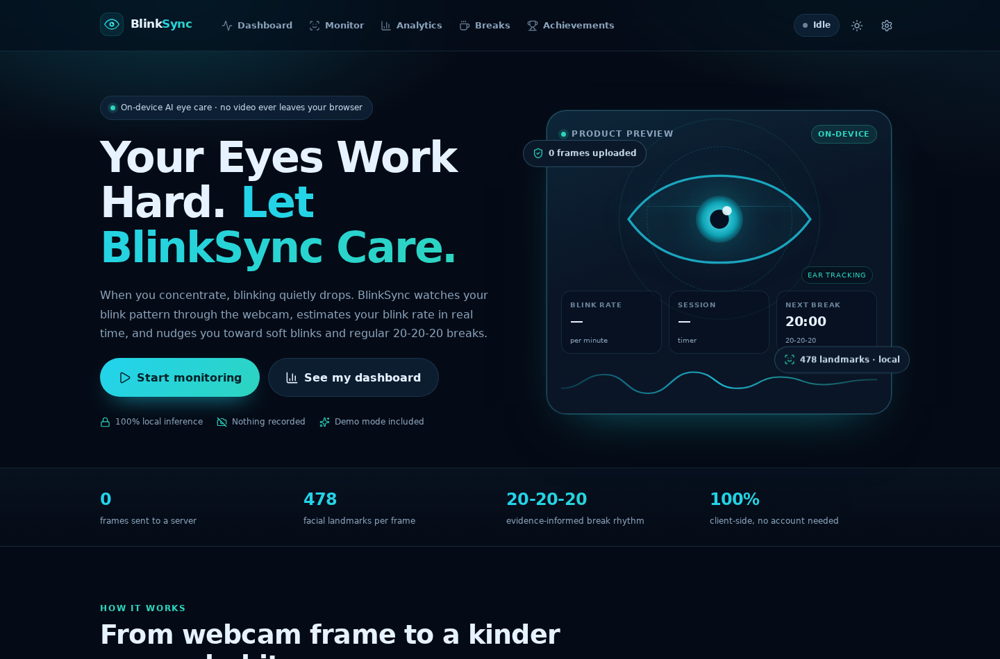
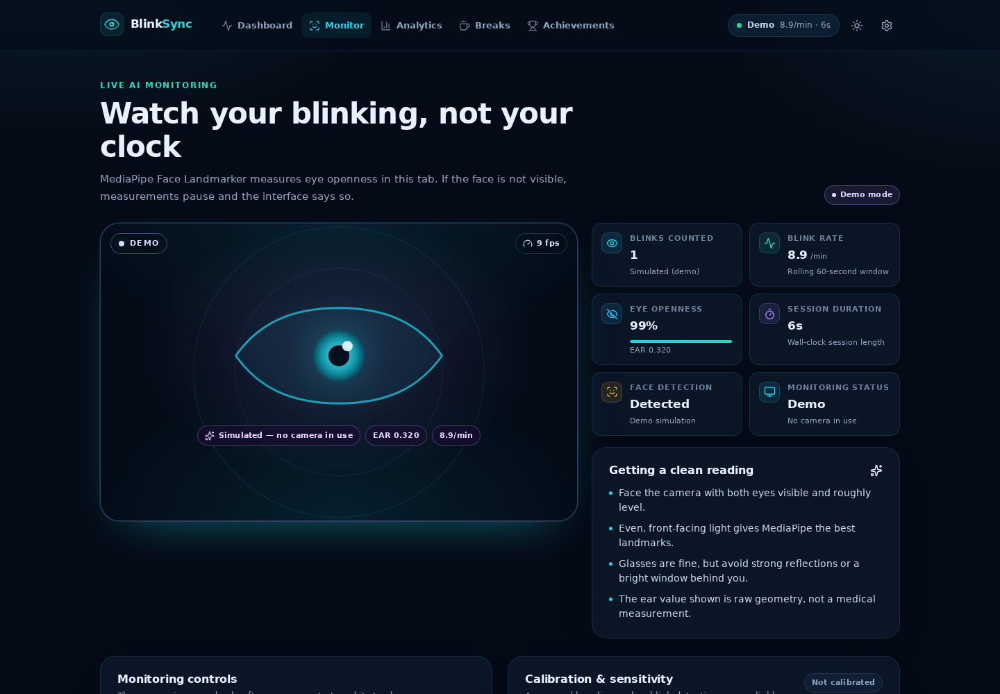
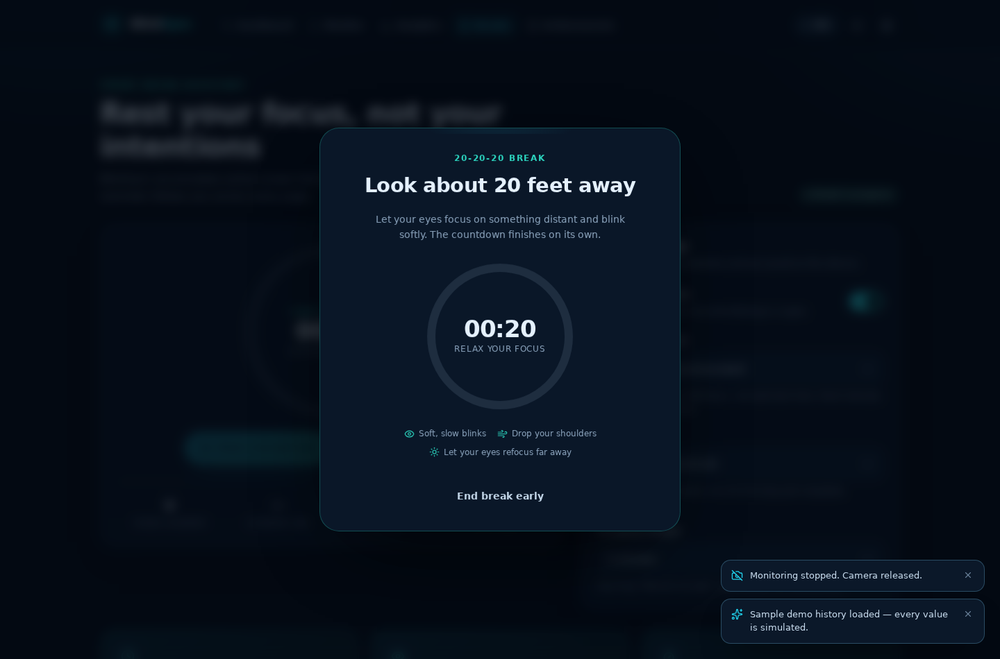
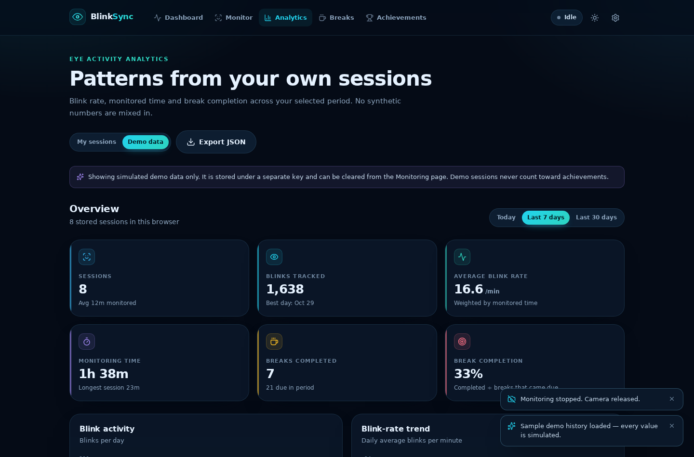
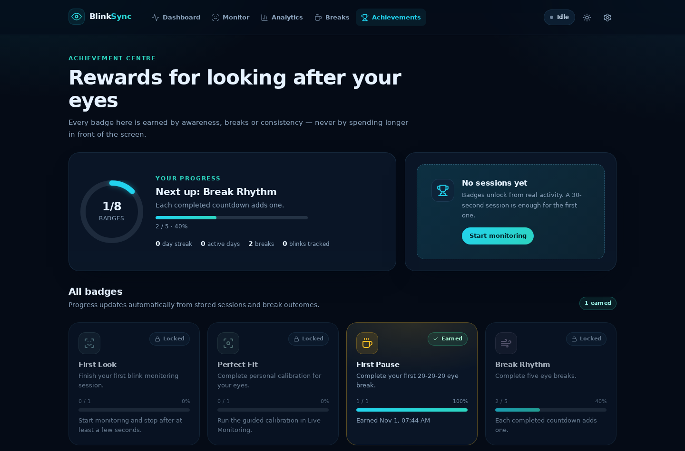
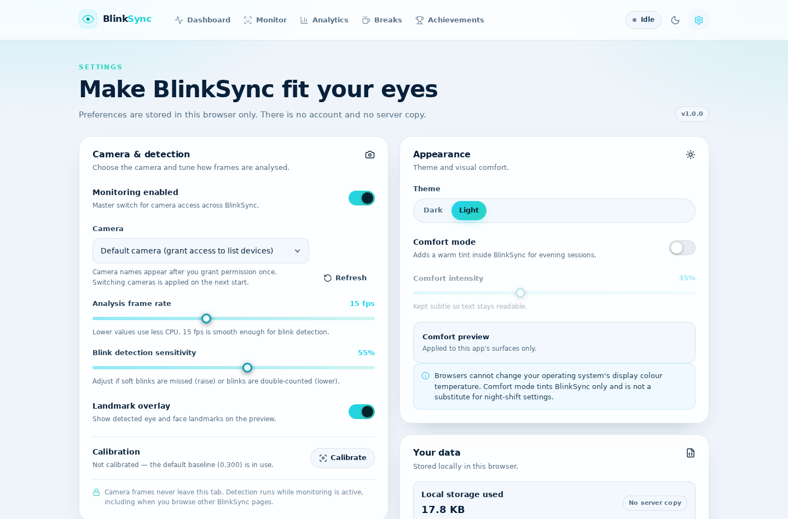
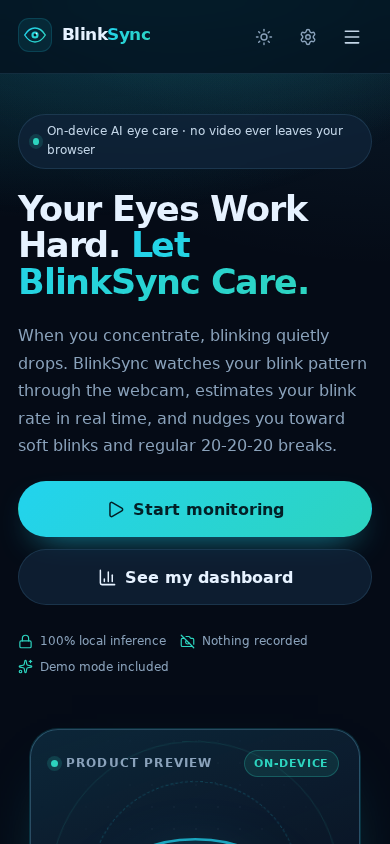

# BlinkSync — Your AI-Powered Eye Care Companion

**BlinkSync** is a privacy-first eye-care awareness app that measures blinking with on-device computer vision, warns you when your blink rate dips, guides the 20-20-20 break rule, and turns your sessions into honest, understandable analytics.

Built from scratch as a competitive hackathon project: React + Vite front end, MediaPipe Face Landmarker for facial landmarks, Eye Aspect Ratio for eye openness, and **no backend at all**. Frames are processed inside the browser tab and never uploaded, recorded or stored.



---

## Table of contents

1. [The problem](#1-the-problem)
2. [The solution](#2-the-solution)
3. [Features](#3-features)
4. [Technology stack](#4-technology-stack)
5. [Architecture](#5-architecture)
6. [How blink detection works](#6-how-blink-detection-works)
7. [How the 20-20-20 assistant works](#7-how-the-20-20-20-assistant-works)
8. [Data model and local storage](#8-data-model-and-local-storage)
9. [Privacy and camera handling](#9-privacy-and-camera-handling)
10. [Demo mode](#10-demo-mode)
11. [Getting started](#11-getting-started)
12. [Testing](#12-testing)
13. [Screenshots](#13-screenshots)
14. [Limitations](#14-limitations)
15. [Future improvements](#15-future-improvements)

---

## 1. The problem

People spend hours each day looking at screens. Sustained near-focus work and concentration can reduce blink frequency and lead to incomplete blinks, which may contribute to eye dryness and discomfort. Most people never notice their blinking habits and forget to take regular visual breaks.

## 2. The solution

BlinkSync closes the loop between **awareness → behaviour → feedback**:

- The webcam and MediaPipe Face Landmarker measure eye openness in real time.
- A smoothed Eye Aspect Ratio (EAR) state machine counts real open→closed→open blinks.
- A rolling 60-second blink rate feeds gentle, rate-limited reminders when blinking looks reduced.
- A global 20-20-20 break scheduler prompts a 20-second distance break, with snooze and honest outcome tracking.
- Dashboard and analytics pages chart only data the user actually produced.
- Optional personal calibration adapts detection thresholds to a user's eyes and camera distance.
- Demo Mode makes the entire experience demonstrable without any camera hardware, with simulated values clearly labelled and stored separately.

BlinkSync is an awareness and wellness tool. **It is not a medical device and does not diagnose, treat or prevent any condition.**

---

## 3. Features

| Area | What it does |
| --- | --- |
| **Landing page** | Product story, animated eye preview, how-it-works steps, feature grid, privacy statement, 20-20-20 benefits, CTA |
| **Guided onboarding** | Four-step introduction to monitoring, EAR, blinking, the 20-20-20 rule, camera permissions and privacy; skippable |
| **Live AI monitoring** | Real MediaPipe landmark detection, live camera preview, EAR readout, blink count, rolling rate, session timer, face-detection status, detection FPS, optional landmark overlay |
| **Blink detection** | EAR landmark geometry, median smoothing, hysteresis thresholds, minimum/maximum blink duration, debounce cooldown, frame-gap recovery, face-loss handling, head-movement rejection |
| **Personal calibration** | Four-second guided baseline capture, automatic on the first live session, manual re-run, reset, sensitivity slider |
| **Smart analysis** | Rolling 60-second rate, configurable low-blink thresholds, cooldown between nudges, rotating non-intrusive messages |
| **20-20-20 assistant** | Screen-time accumulation, global reminder on every page, animated 20-second countdown, snooze/skip, completed-break history, configurable intervals for demos |
| **Dashboard** | Six live/period stat tiles and four Recharts visualisations (blink activity, rate trend, session counts, break completion) with Today / 7-day / 30-day periods |
| **Analytics** | Weighted averages, per-day buckets, session table, reflective insights, break completion rate, demo-data source switch, JSON export |
| **Achievements** | Eight badges for awareness, breaks, calibration and consistency — never for screen time; progress, streaks and unlock dates |
| **Settings** | Camera selection, monitoring toggle, analysis FPS, sensitivity, landmark overlay, reminders and sound, break interval/length/postpone, dark/light theme, comfort mode, export, reset, delete-all |
| **Comfort mode** | Adjustable warm in-app tint, explicitly scoped to BlinkSync (browsers cannot change OS display temperature) |
| **Privacy page** | Plain-language data map, exact localStorage keys, camera lifecycle, limitations, About section |
| **Demo mode** | Deterministic simulated blink trace, visual “simulated” preview, separate storage key, sample history generator, excluded from achievements and real analytics |
| **Quality** | Exception-safe camera/model/audio code, accessible controls, keyboard-friendly modals, responsive layouts, cleanup of timers, streams and animation frames |

---

## 4. Technology stack

| Layer | Choice |
| --- | --- |
| UI | React 19 (JSX) + Vite 8 |
| Styling | Hand-written CSS3 design system, CSS custom properties, dark + light themes, glassmorphism |
| Computer vision | `@mediapipe/tasks-vision` 1.2 · Face Landmarker (478 landmarks), WASM runtime served locally |
| Charts | Recharts 3 |
| Icons | Lucide React |
| Audio | Web Audio API (generated chimes, no audio files) |
| Persistence | Browser `localStorage` with a validated repository layer |
| Testing | Vitest (126 unit tests) + Playwright browser QA |
| Routing | Small hash-based router (works on any static host, including GitHub Pages) |
| Backend | **None** |

---

## 5. Architecture

```
src/
├── App.jsx                    route table + providers
├── main.jsx                   entry point
├── context/
│   ├── AppContext.jsx         settings, sessions, breaks, achievements, toasts, 20-20-20 scheduler heartbeat
│   └── MonitorContext.jsx     camera lifecycle, MediaPipe loop, calibration, session autosave, demo engine
├── lib/                       framework-free logic (all unit tested)
│   ├── eyeMetrics.js          EAR geometry, face scale, head-stability filter
│   ├── blinkDetector.js       hysteresis blink state machine
│   ├── blinkRate.js           rolling 60-second rate
│   ├── reminderEngine.js      low-blink nudge policy + cooldowns
│   ├── calibration.js         guided baseline collector
│   ├── sessionTracker.js      monitored time, blinks, samples, record output
│   ├── breakTimer.js          pure 20-20-20 scheduler state machine
│   ├── analytics.js           period buckets, weighted averages, streaks
│   ├── achievements.js        badge definitions, progress, unlock persistence
│   ├── storage.js             validated localStorage repository + export/reset
│   ├── settingsSchema.js      settings sanitisation and calibration validation
│   ├── camera.js              getUserMedia, device listing, friendly error mapping
│   ├── faceLandmarker.js      lazy MediaPipe loader with GPU→CPU fallback
│   ├── demoSimulator.js       deterministic simulated blinks + demo history
│   ├── audio.js               Web Audio chimes
│   ├── format.js              duration/rate/date formatting
│   └── router.jsx             hash router with in-page anchors
├── components/
│   ├── layout/                navbar, footer, app shell, break overlay, comfort overlay
│   ├── monitor/               camera stage, landmark canvas, live metrics, controls, calibration card
│   ├── charts/                chart wrappers, tooltip, activity/rate/session/break charts
│   └── ui/                    buttons, cards, fields, toggles, modal, ring, toast, badges, empty states
├── pages/                     Landing, Onboarding, Dashboard, Monitor, Analytics, Breaks,
│                              Achievements, Settings, Privacy, 404
└── styles/                    base.css, layout.css, pages.css, monitor.css
```

### Runtime data flow

```
<video> frame
   │  (requestAnimationFrame, throttled to 5–30 fps)
   ▼
MediaPipe FaceLandmarker.detectForVideo  ──►  478 landmarks (in-memory only)
   │
   ├─► measureEyes()  ──►  left/right EAR  ──►  FaceStabilityFilter
   │                                              │ (reject head movement)
   │                                              ▼
   │                                       BlinkDetector.feed()
   │                                              │ open → closed → open
   │                                              ▼
   │                                        blink event
   │                                              │
   ├─► CalibrationCollector (first session)      ├─► BlinkRateTracker (60 s window)
   │        │                                     ├─► SessionTracker (counts, samples, autosave)
   │        └─► personal EAR baseline            └─► BlinkReminderEngine (nudges + cooldown)
   │
   ▼
MonitorContext publishes stats at ~3 Hz  ──►  UI (no re-render per frame)
```

The media pipeline is deliberately separate from React: landmarks stay in a ref, the canvas overlay draws itself in its own `requestAnimationFrame`, and published state is throttled.

---

## 6. How blink detection works

### 6.1 Landmarks and geometry

MediaPipe Face Landmarker returns 478 normalised 3D landmarks per face. BlinkSync uses six lid points per eye (the classic Eye Aspect Ratio formulation):

| Eye | Points (MediaPipe indices) |
| --- | --- |
| Left eye | `33` outer, `160` upper A, `158` upper B, `133` inner, `144` lower A, `153` lower B |
| Right eye | `362` outer, `385` upper A, `387` upper B, `263` inner, `373` lower A, `380` lower B |

```
EAR = ( |p160 − p144| + |p158 − p153| ) / ( 2 · |p33 − p133| )
```

Horizontal distances are corrected by the video frame's aspect ratio so a wide webcam image does not distort the ratio. The two eyes are measured independently and averaged; if one eye is occluded, the other is still usable.

### 6.2 Turning EAR into blinks

A raw threshold on single frames produces false counts. BlinkSync applies:

1. **Median smoothing** over the last 3 frames.
2. **Hysteresis thresholds** derived from the calibrated open-eye baseline:
   - close below `baseline × closeRatio`
   - reopen above `baseline × openRatio`
   - `closeRatio = 0.82 − 0.26 × sensitivity`, `openRatio = min(0.96, closeRatio + 0.15)`
3. **Duration window** — a blink only counts if the eye was closed for **60–600 ms**. Short lid flicker is ignored.
4. **State machine** — a blink requires a complete open → closed → open transition. A long closure produces a `prolonged-closure` event and is **never** split into multiple blinks.
5. **Cooldown** — 90 ms minimum between counted blinks.
6. **Frame-gap recovery** — if more than 450 ms pass without a frame (tab hidden, model stall), the state machine resets instead of guessing.
7. **Face-loss handling** — landmarks disappear for more than 700 ms → measurement pauses, the UI says “no face detected”, and the state machine resets.
8. **Head-movement rejection** — the inter-outer-eye distance is tracked; sudden ±22% changes are treated as unstable frames and are not fed to the blink counter.

### 6.3 Calibration

Before the first live session BlinkSync collects open-eye EAR samples for four seconds (~15+ samples after filtering clearly-closed frames) and stores the **median** as the personal baseline. Calibration:

- adapts thresholds to eye shape and camera distance;
- is stored locally with its timestamp and sample count;
- can be re-run or reset at any time;
- starts from a documented default of `0.300` when skipped.

Calibration improves usability; it does not make the reading clinically accurate.

### 6.4 Blink rate and reminders

- A **rolling 60-second window** counts blink events and divides by the observed monitoring time (minimum 5 seconds before a rate is shown).
- Monitoring time only accumulates while a face is detected, and a single tick is capped at 1.5 s so a suspended tab cannot inflate it.
- Reminder presets:

| Preset | Nudge below | Minimum gap |
| --- | --- | --- |
| Gentle | 8 blinks/min | 5 minutes |
| Balanced (default) | 12 blinks/min | 3 minutes |
| Attentive | 16 blinks/min | 2 minutes |

Messages rotate (“Remember to blink naturally.”, “Take a moment to relax your eyes.”, …). The engine also waits for a 45-second warm-up and requires a visible face. Thresholds are **configurable heuristics, not medical targets**.

### 6.5 Performance strategy

- Target frame rate is user-configurable (5–30 fps; default 15) and enforced with a timestamp gate inside a single animation frame loop.
- MediaPipe is dynamically imported only when monitoring starts.
- React dashboard state updates about three times per second; the landmark overlay never triggers React renders.
- GPU delegate is attempted first, with automatic CPU fallback.
- Camera tracks, animation frames, timers, audio and the hidden detection video are released on stop/unmount/page hide.

---

## 7. How the 20-20-20 assistant works

The break scheduler is a pure state machine (`src/lib/breakTimer.js`):

- Active screen time is accumulated **only while the tab is visible** and reminders are enabled.
- A single delta is capped at 2 s, so sleeping/suspended tabs do not jump the timer.
- At the interval (default 20 minutes) the scheduler enters `due` and the global modal appears on **any** in-app page.
- “Start break” runs a configurable countdown (default 20 s) with an animated ring and auto-completes.
- “Remind me later” postpones by the configured snooze time; “Skip” resets the interval.
- Outcomes are stored honestly: `completed`, `postponed` or `skipped` — postponing is never counted as a completed break.
- Short intervals (1–5 minutes) are available for hackathon demonstrations and are labelled as such.

The scheduler’s 1-second heartbeat lives in `AppContext`, which is why the reminder survives navigation between pages.

---

## 8. Data model and local storage

Only summaries are persisted. Example session record:

```json
{
  "id": "live-1762000000000-a1b2c3",
  "mode": "live",
  "simulated": false,
  "startedAt": 1762000000000,
  "endedAt": 1762000360000,
  "durationMs": 360000,
  "monitoredMs": 342000,
  "blinkCount": 78,
  "averageBlinkRate": 13.7,
  "peakBlinkRate": 21.0,
  "lowestBlinkRate": 7.2,
  "calibration": { "openBaseline": 0.291, "source": "guided", "updatedAt": 1761999000000 },
  "series": [{ "t": 15, "rate": 12.0, "blinks": 3 }]
}
```

| Key | Contents |
| --- | --- |
| `blinksync.settings.v1` | Theme, camera id, sensitivity, calibration, reminder and break preferences |
| `blinksync.sessions.v1` | Real session summaries (max 250) |
| `blinksync.demo-sessions.v1` | Simulated demo sessions, separate by design |
| `blinksync.breaks.v1` | Break due time, outcome, duration, snooze count (max 500) |
| `blinksync.achievements.v1` | Badge id → unlock timestamp |

All reads are validated and sanitised (`settingsSchema.js`, `storage.js`), so corrupted or hand-edited values cannot break the app. Settings can be exported together with sessions, breaks and achievements as JSON, or deleted entirely.

---

## 9. Privacy and camera handling

- **Frames stay in the tab.** They are read from a video element, converted to landmarks in WebAssembly memory, and discarded after each detection. There is no upload, recording, screenshotting or landmark transmission.
- **No backend.** The app is static. The only network requests are for its own code and the locally served MediaPipe model/WASM assets.
- **Explicit start only.** The camera opens after a user action and a browser permission prompt; it never opens on page load.
- **Immediate release.** Stopping monitoring calls `track.stop()`, removes the hidden video element and clears the preview. Pausing stops analysis without dropping the stream; the UI says so.
- **Minimum storage.** Only session summaries, break outcomes, achievements and preferences are written to `localStorage`.
- **Full user control.** Export everything as JSON, reset all statistics while keeping preferences, or delete every BlinkSync key including calibration.
- **No third-party tracking**, ads, fingerprinting, face recognition or emotion inference.

---

## 10. Demo mode

Demo mode exists so the full product can be demonstrated at a venue without camera access:

- Deterministic simulated blink trace with realistic open/closed EAR values and occasional face-loss moments.
- The camera stage shows an animated eye with **“Simulated — no camera in use”** and a live EAR readout.
- The navbar status says **DEMO**.
- Demo sessions use a separate storage key, are marked `simulated: true`, and are **excluded from achievements and real analytics**.
- Analytics has an explicit data-source switch: “My sessions” vs “Demo data”, with a visible simulated-data warning.
- “Load sample history” generates seven days of clearly labelled demo sessions and break outcomes; “Clear demo data” removes them without touching real data.

---

## 11. Getting started

### Requirements

- Node.js **20.19+** or **22.12+** (required by Vite 8)
- npm 10+
- A modern Chromium, Edge, Firefox or Safari browser
- Camera access served from **HTTPS** or **`localhost`** (browser requirement)

### Install and run

```bash
npm install       # also copies MediaPipe WASM into public/mediapipe/wasm
npm run dev       # http://localhost:5173
```

Open the printed URL, choose **Start monitoring**, allow the camera, and hold a relaxed open-eyed gaze during the four-second calibration. If you do not have a camera, choose **Start demo mode** from the Live Monitoring page.

If `public/mediapipe/wasm` is ever missing (for example after a partial checkout), restore it with:

```bash
npm run setup:assets
```

### Production build

```bash
npm run build     # outputs dist/
npm run preview   # serves the production build
```

The 3.7 MB Face Landmarker model is committed at `public/models/face_landmarker.task`; the WASM runtime is copied from `node_modules` on install. Host `dist/` over HTTPS (GitHub Pages, Netlify, Cloudflare Pages, or any static host). Hash routing means deep links work without server rewrites.

### Scripts

| Command | Purpose |
| --- | --- |
| `npm run dev` | Vite dev server |
| `npm run build` | Production bundle |
| `npm run preview` | Serve the production bundle |
| `npm test` | Run all unit tests once |
| `npm run test:watch` | Watch mode |
| `npm run setup:assets` | Re-copy MediaPipe WASM assets |

### How to demo in 60 seconds

1. Open the app → **Start monitoring** → allow the camera.
2. Let the guided calibration finish (about 4 seconds), then blink normally.
3. Open **Settings → Break assistant** and set the interval to **1 minute** to show the full 20-20-20 loop quickly, then restore it to 20.
4. Stop monitoring to save the session and open **Dashboard** / **Analytics**.
5. No camera? Use **Demo mode** and **Load sample history**, then switch Analytics to **Demo data**.

---

## 12. Testing

### Automated unit tests

**126 tests across 13 files, all passing** (`npm test`):

| File | Coverage |
| --- | --- |
| `eyeMetrics.test.js` | Aspect-corrected EAR, missing landmarks, openness clamping, median, stability filter |
| `blinkDetector.test.js` | Complete blinks, short flicker, prolonged closure, dropped frames, face loss, cooldown, baseline changes, smoothing, sensitivity |
| `blinkRate.test.js` | Warm-up gating, rolling window, pruning, rate scaling |
| `sessionTracker.test.js` | Monitored time, delta caps, averaging, sampled series, demo flag |
| `breakTimer.test.js` | Interval accumulation, due-once, full break, snooze, skip, hidden-tab behaviour, forced break, early exit |
| `calibration.test.js` | Median baseline, minimum samples, invalid samples, cancellation |
| `analytics.test.js` | Weighted averages, daily buckets, demo source, break completion, empty periods, streaks |
| `achievements.test.js` | Capping, break counting, streaks, unlock-once persistence |
| `storage.test.js` | Sanitised settings, corrupted JSON, upsert, demo separation, export, reset, delete-all |
| `reminderEngine.test.js` | Thresholds, cooldown, warm-up, message rotation, disabled/face-absent |
| `settingsSchema.test.js` | Range clamping, enum fallback, calibration validation |
| `demoSimulator.test.js` | Determinism, blink production, simulated flags, sample history |
| `format.test.js` | Durations, countdowns, percentages, relative time |

```text
Test Files  13 passed (13)
     Tests  126 passed (126)
```

### Production build

```text
vite v8.3.5 · 2683 modules transformed
dist/assets/index-*.css   63.64 kB │ gzip: 12.78 kB
dist/assets/index-*.js   788.67 kB │ gzip: 231.34 kB
✓ built in ~1.1s
```

### Browser QA (Playwright + Chromium)

A real browser smoke suite was run against the dev server at 1440×950 and 390×844. **21/21 checks passed with zero console or page errors**, covering:

- Landing render, navigation, onboarding wizard and skip-to-dashboard
- Empty-state honesty (no fabricated analytics)
- Demo monitoring (simulated blinks, rate, stop & save)
- Demo history → four populated analytics charts + demo warning
- Manual break countdown completing in ~20 s
- A real 1-minute break reminder firing and a 10-second countdown completing
- Achievement grid and earned badge
- Theme switch persisted in `localStorage` and across reload
- Privacy page data map and limitations
- Camera permission denial showing an actionable error panel (API stubbed to `NotAllowedError`)
- Six stat tiles + honest empty charts on the dashboard
- Responsive landing/dashboard/monitor with no horizontal overflow at 390 px
- **MediaPipe runtime:** model + WASM initialised in 622 ms in Chromium, the GPU delegate fell back to CPU automatically, and two `detectForVideo` passes on a synthetic non-face canvas returned zero faces without throwing

**What was not tested here:** this build environment has no physical camera, so a real face-landmark feed, landmark tracking of a real face, and live blink accuracy could not be exercised end-to-end. The AI runtime, camera permission-denial path, calibration logic, zero-face detection, blink state machine and cleanup logic are verified, but live-camera accuracy should be validated on a laptop with a webcam before a stage demo. Multiple simultaneous faces and extremely low-light conditions were not tested.

---

## 13. Screenshots

| Live monitoring (demo) | 20-20-20 break |
| --- | --- |
|  |  |

| Analytics with demo source | Achievements |
| --- | --- |
|  |  |

| Settings (light theme) | Mobile landing |
| --- | --- |
|  |  |

Additional captures: [onboarding](artifacts/02-onboarding.png), [empty dashboard](artifacts/03-dashboard-empty.png), [privacy page](artifacts/09-privacy.png), [camera permission error](artifacts/10-camera-denied.png), [dashboard](artifacts/11-dashboard.png), [mobile dashboard](artifacts/13-mobile-dashboard.png), [mobile monitor](artifacts/14-mobile-monitor.png).

---

## 14. Limitations

- **Not a medical device.** No diagnosis, treatment or prevention claims. Blink rate varies widely between people and tasks, so BlinkSync compares you with your own recent pattern rather than a universal “healthy” number.
- **Webcam estimates are approximate.** Lighting, glasses, make-up, head angle, occlusion and camera quality all affect landmark geometry.
- **One face at a time** (`numFaces: 1`); background faces are ignored.
- **Head pose matters.** Extreme yaw/pitch or a face leaving the frame pauses measurement. The stability filter rejects sudden scale changes but cannot correct every pose.
- **Browser resources.** MediaPipe runs in WebAssembly; low-end devices may benefit from a lower analysis frame rate.
- **Local-only data.** No accounts, sync or cloud backup. Clearing browser data removes history; export a JSON copy if you want to keep it.
- **Storage caps.** The newest 250 sessions and 500 break outcomes are retained.
- **Comfort mode is in-app only.** Browsers cannot change the operating system's display colour temperature.
- **Demo values are simulated** and are separated from real measurements everywhere.
- **Camera requires HTTPS or localhost**; some managed browsers block camera access entirely.
- **No real-camera end-to-end test was possible in this environment** (see Testing).

---

## 15. Future improvements

- Optional IndexedDB storage for longer history and per-minute series.
- Face-pose-aware EAR normalisation using MediaPipe's transformation matrix.
- Blink completeness (partial vs full blink) estimation and blink-duration trends.
- Optional encrypted export/import for moving data between devices.
- PWA install + local notification support for reminders outside the tab.
- Web Worker or OffscreenCanvas detection loop to keep the main thread even freer.
- Slower “long-session” nudges in addition to low-blink nudges.
- Localisation and configurable units.
- An opt-in, fully local WebGPU delegate when available.

---

## Credits

- [MediaPipe Tasks Vision](https://developers.google.com/mediapipe) — Face Landmarker, Apache-2.0. Model: `face_landmarker.task` (float16).
- [React](https://react.dev) and [Vite](https://vite.dev) — MIT.
- [Recharts](https://recharts.org) — MIT.
- [Lucide](https://lucide.dev) — ISC.
- Eye Aspect Ratio formulation based on Soukupová & Čech (2016), *Real-Time Eye Blink Detection using Facial Landmarks*.

BlinkSync is an independent hackathon project. It is not affiliated with Google or MediaPipe.
